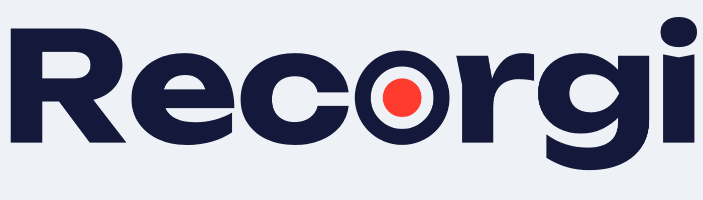

<p align="center">
  <picture>
    <source media="(prefers-color-scheme: dark)" srcset="docs/images/wordmark-dark.png">
    
  </picture>
</p>

<p align="center">Native screen and audio recording for Mac.<br>Open source · no virtual audio devices · no telemetry</p>

<p align="center">
  
  
  <a href="LICENSE"></a>
</p>

<p align="center"><a href="README.md">Русский</a> · <strong>English</strong><br><a href="#installation">Install</a> · <a href="#videos-and-editable-sources">Videos and sources</a> · <a href="#building-from-source">Build</a> · <a href="CHANGELOG.md">Changelog</a></p>

---

Recorgi records your screen, application audio and microphone using native macOS frameworks. Choose a region, enable your audio sources and start recording. Open the finished video in your usual player, or edit its original sources inside Recorgi.

## Features

| | What Recorgi does |
| --- | --- |
| **Screen** | Record the full screen, a particular display, a window, or a region you drag out with a visible border. |
| **Audio** | Capture system audio or a selected application's audio, record your microphone, adjust volume and monitor the microphone. |
| **Controls** | Pause and resume, assign global keyboard shortcuts, and control recording from the menu bar. |
| **Formats** | H.264 and HEVC, MOV and MP4, and several resolution and frame-rate presets. |
| **Editor** | Trim, change speed, adjust volume over time, and control each source and microphone noise suppression when separate tracks are available. |
| **Library** | Search, sort, group by date, rename, reveal in Finder and move recordings to the Trash. |
| **Appearance** | Light and dark themes, a custom accent colour, Liquid Glass on macOS 26+, and a compatible appearance on older systems. |

Built with **Swift, SwiftUI and AppKit**, without Electron. The app interface is currently Russian-only. Third-party OBS plugin support through `libobs` is planned but not implemented.

## Installation

1. Download a `.dmg` from [Releases](../../releases) if a prebuilt image is available for the version you want.
2. Open the image and drag **Recorgi.app** to **Applications**.
3. Allow screen recording and microphone access when macOS asks. Permissions are managed in **System Settings → Privacy & Security**.

Prebuilt images use ad-hoc signing and are not notarized by Apple. If macOS blocks the first launch of a downloaded build, attempt to open it, then visit **System Settings → Privacy & Security** and choose **Open Anyway** for Recorgi.

This README describes the current `main` branch. A published release may have fewer features. [Build from source](#building-from-source) to use the current code.

## Videos and editable sources

**You do not need to export manually just to watch a recording.** After you stop, Recorgi prepares a video with the microphone and system audio mixed together. Open it in QuickTime or share it with someone else. The video stream is copied without re-encoding.

When a recording has separate audio tracks, its original is saved alongside it:

```text
Recorgi 2026-11-06 at 12.00.00.mp4          ← ready-to-watch video with mixed audio
Recorgi 2026-11-06 at 12.00.00.mp4 — исходники/
└── Original.mp4                          ← original with separate audio tracks
```

The folder suffix **«исходники»** means **sources**. The Russian interface provides these actions:

- **«Открыть» — Open** launches the finished video in your default player.
- **«Редактировать» — Edit** automatically opens the original, allowing independent microphone and system-audio adjustments.
- **«Сохранить как новый файл» — Save as new file** creates another finished video with your edits. The original stays available for further editing.

During processing, the app displays **«Подготавливаем видео…» — Preparing video…**. Keep the video and its source folder together when moving them. Renaming or deleting a recording through the library handles both together. Retaining originals uses additional disk space.

> **Separate tracks depend on the capture mode and macOS version.** The primary recording mode retains separate sources on macOS 27+. On macOS 15–26, that mode receives already mixed audio, so the sources cannot be adjusted independently afterwards. Application-scoped audio capture uses a pipeline with separate tracks. Recordings with a single audio track do not get a separate source folder.

## Building from source

### Requirements

| Purpose | Requirement |
| --- | --- |
| **Run the app** | macOS 15 or later. Liquid Glass is available on macOS 26+. |
| **Compile the current code** | Full Xcode with **macOS SDK 27 or later** and Swift 6.2+. Xcode 26 with macOS SDK 26 is insufficient, even on a newer host OS. |
| **Generate the project** | [XcodeGen](https://github.com/yonaskolb/XcodeGen). If missing, `bootstrap.sh` installs it through [Homebrew](https://brew.sh), provided Homebrew is already installed. |
| **Sign a Release build** | No certificate or Apple Developer account required: Release uses ad-hoc signing. |
| **Sign a Debug build** | Your own local `Recorgi Local Dev` certificate, created once using the instructions below. |

A clean Release build has been verified on **Apple Silicon, Xcode 27.2, macOS SDK 27.2 and XcodeGen 2.46.0**. Running on macOS 15–26 and building on an Intel Mac have not been separately verified. All three Swift packages are included in the repository; the app has no external package dependencies.

### Quick start without a certificate

Clone the repository or extract a source archive. From its root directory, run:

```sh
./Scripts/bootstrap.sh
xcodebuild -project Recorgi.xcodeproj -scheme Recorgi \
  -configuration Release -derivedDataPath .build/release build
open .build/release/Build/Products/Release/Recorgi.app
```

`bootstrap.sh` checks the selected Xcode installation and SDK version. If a different installation is selected, choose the intended one in **Xcode → Settings → Locations → Command Line Tools**.

### Debug builds for development

Debug uses a stable local certificate so macOS can retain permissions across rebuilds. Create **your own** certificate on your Mac:

1. Open **Keychain Access → Certificate Assistant → Create a Certificate…**
2. Name: **`Recorgi Local Dev`**. Identity Type: **Self Signed Root**. Certificate Type: **Code Signing**.
3. Find it in the **login** keychain, open it and set **Trust → Code Signing → Always Trust**.

Then open `Recorgi.xcodeproj` in Xcode and run the **Recorgi** scheme with ⌘R, or use:

```sh
xcodebuild -project Recorgi.xcodeproj -scheme Recorgi \
  -configuration Debug -derivedDataPath .build/xcode build
open .build/xcode/Build/Products/Debug/Recorgi.app
```

Fully quit any running Recorgi instance before launching a new build. Your certificate and private key stay on your Mac; other contributors do not need them.

### Build a DMG

After the initial tool setup:

```sh
./Scripts/make-dmg.sh
```

The script builds an ad-hoc-signed Release and creates `dist/Recorgi-<version>.dmg`, including an Applications shortcut and the changelog. It does not perform notarization.

## Project layout

```text
Recorgi/                  App target, menu bar, resources and branding
Packages/
├── RecorgiCore/           Models, settings and logging
├── RecorgiCapture/        Capture, audio, permissions and video processing
└── RecorgiUI/             SwiftUI interface and editor
Scripts/                  Project setup and DMG packaging
project.yml               XcodeGen project specification
```

Dependencies flow from **RecorgiCore → RecorgiCapture → RecorgiUI → app**.

`Recorgi.xcodeproj` is generated and is not tracked in Git. Run `xcodegen generate` after editing `project.yml` or adding/removing source files. For a quick package check, run `swift build` inside that package's directory. There is no permanent automated test suite yet; see [CLAUDE.md](CLAUDE.md) for architecture and the development workflow.

## Local data

Recordings are saved to `~/Movies/Recorgi` by default; you can change the folder in settings. Videos, settings and diagnostic logs remain on your Mac. The app does not send telemetry.

Local tool configurations, `.env` files and private keys are excluded through `.gitignore`. Review diagnostic logs before publishing them: window titles, application names and file paths help troubleshooting and may contain personal information.

## License

**[GPL-3.0-or-later](LICENSE).** The bundled Unbounded font's licence is included in [Recorgi/Fonts/OFL.txt](Recorgi/Fonts/OFL.txt).
