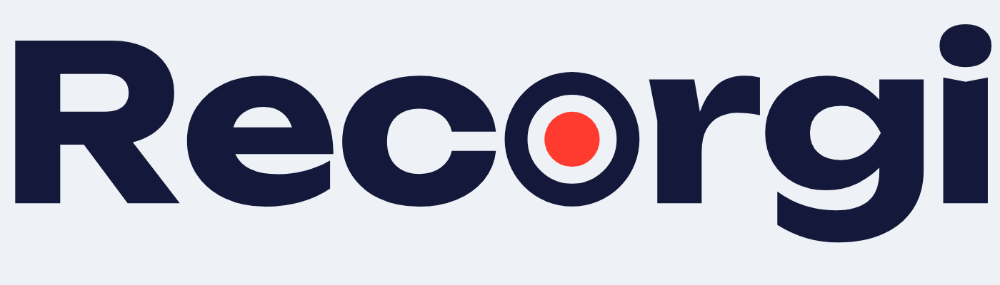
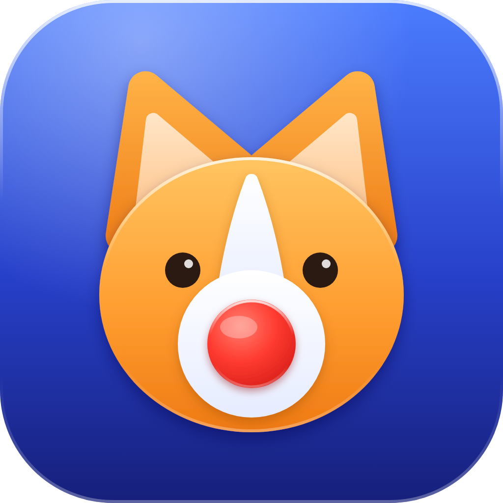

<p align="center">
  <picture>
    <source media="(prefers-color-scheme: dark)" srcset="docs/images/wordmark-dark.png">
    
  </picture>
</p>

<p align="center">
  A native, fully open-source screen recorder for macOS. No Electron, no virtual audio devices, no telemetry.
</p>

<p align="center">
  
</p>

## What it does

Recorgi records your screen — the whole display, a single display, a specific window, or a region you drag out by hand — together with system audio and/or your microphone as **independent tracks**, muxed into one `.mov`/`.mp4` file by `AVAssetWriter`. No BlackHole-style virtual audio devices, no routing hacks.

- **Capture sources** — primary display, any display, any window, or a custom dragged area (with a persistent on-screen border while it's selected or recording).
- **Independent audio tracks** — system audio (all of it, or scoped to one running app) and microphone, toggled on/off independently, recorded as separate tracks in the same file.
- **Global hotkeys** — start/stop, toggle microphone, toggle system audio. Work even when Recorgi isn't the focused app, fully reassignable, with a reset-to-defaults button.
- **Menu bar presence** — a status item with its own icon per state (idle / recording / starting-stopping) so Recorgi keeps running and stays reachable after you close its window.
- **Format control** — choose the video codec (H.264/HEVC), container (`.mov`/`.mp4`), and a resolution/frame-rate quality tier.
- **Recordings library** — search, sort, group by date, rename, reveal in Finder, and open a built-in trim/export player, all from one page.
- **Liquid Glass UI** — a native SwiftUI interface that follows the system's own transparency and accent-color settings, with an optional custom accent and light/dark/system appearance.

## Status

**Working:** everything in the list above — display/window/area capture, independent audio tracks, global hotkeys, the menu bar icon, codec/container/quality settings, the recordings library and editor, and the Liquid Glass UI.

**Not yet implemented:** loading real third-party OBS plugins via `libobs`. That's the long-term goal driving this project's GPL-3.0-or-later license (see [License](#license)) — the plumbing for it doesn't exist yet, so don't go looking for plugin-loading code.

**Known limitation:** the UI is currently Russian-only.

## Screenshots

> Coming soon. If you'd like to help: launch Recorgi (see below), then for each page run `screencapture -i docs/images/screenshots/<name>.png` from a terminal and click the window — save as `record.png`, `capture-region.png`, `audio-sources.png`, `library.png`, `settings.png`, and `menubar.png` to match what a future revision of this README will embed.

## Installing a prebuilt build

Grab the `.dmg` from this repo's [Releases](../../releases) page (or build one yourself — see below), open it, and drag `Recorgi.app` into `Applications`.

Recorgi isn't notarized — that requires a paid Apple Developer Program membership, which this project doesn't have — so on first launch **Gatekeeper will say it's from an "unidentified developer."** This is expected for an app built this way, not a sign of tampering. To open it anyway:

1. **Right-click (or Control-click) `Recorgi.app` → Open**, then confirm in the dialog that appears. If macOS doesn't offer an "Open Anyway" option here, go to **System Settings → Privacy & Security**, scroll down, and click **Open Anyway** next to Recorgi, then launch it again.
2. If that still doesn't work, clear the quarantine flag yourself from Terminal: `xattr -cr /Applications/Recorgi.app`.

The first time you hit record, macOS will separately prompt for **Screen Recording** and, if you enable the microphone, **Microphone** access — grant both in System Settings → Privacy & Security.

## Building from source

### Requirements

- macOS 26 or later, both to build and to run — the UI is built on this release's Liquid Glass SwiftUI APIs (`glassEffect`, `GlassEffectContainer`, `.buttonStyle(.glass)`), which don't exist on earlier versions.
- Xcode 26+ (for the macOS 26 SDK and toolchain).
- [XcodeGen](https://github.com/yonaskolb/XcodeGen) — `Scripts/bootstrap.sh` installs it via Homebrew if it's missing.

### One-time setup: a local code-signing identity

Local Debug builds sign with a **self-signed certificate** named `Recorgi Local Dev`, created once in Keychain Access — not an Apple Developer account. This exists because macOS resets Screen Recording/Microphone permission grants on every rebuild if the app's code identity changes, which it does on every build if you leave it ad-hoc signed; a stable local identity means you only grant those permissions once.

1. Open **Keychain Access** → menu bar **Certificate Assistant → Create a Certificate…**
2. Name it exactly **`Recorgi Local Dev`**, Identity Type **Self Signed Root**, Certificate Type **Code Signing**. Create it.
3. Find it in the **login** keychain, double-click it, expand **Trust**, set **Code Signing** to **Always Trust**.

You only need to do this once per machine.

### Build and run

```sh
git clone <this repo's URL>
cd Recorgi
./Scripts/bootstrap.sh   # installs XcodeGen if needed, generates Recorgi.xcodeproj
open Recorgi.xcodeproj    # build & run from Xcode (⌘R), or:
xcodebuild -project Recorgi.xcodeproj -scheme Recorgi -configuration Debug -derivedDataPath .build/xcode build
open .build/xcode/Build/Products/Debug/Recorgi.app
```

Regenerate the Xcode project (`xcodegen generate`) any time you add/remove files or change `project.yml` — `Recorgi.xcodeproj` itself is generated and gitignored, never hand-edited.

There's no test suite yet. See `CLAUDE.md` for the architecture, the recording pipeline's hard-won fixes, and the full development workflow.

### Building your own `.dmg`

```sh
./Scripts/make-dmg.sh
```

This builds a **Release** configuration, **ad-hoc signed** (no certificate needed — unlike the Debug build above, this needs to run on *other* Macs, which can't trust your machine's local `Recorgi Local Dev` identity), and packages it into `dist/Recorgi-<version>.dmg`. The result has the same "unidentified developer" Gatekeeper behavior described in [Installing a prebuilt build](#installing-a-prebuilt-build) — that's inherent to distributing outside notarization, not a bug in the script.

## Project layout

```
Recorgi/              App target sources (SwiftUI @main entry point, menu bar controller, app icon/brand assets)
Packages/
  RecorgiCore/         Settings, permission, and recording-state models — no AppKit/AVFoundation imports
  RecorgiCapture/      ScreenCaptureKit (video + system audio) + AVCaptureSession (mic) + AVAssetWriter muxing, global hotkeys
  RecorgiUI/           SwiftUI views
project.yml            XcodeGen spec — the source of truth for Recorgi.xcodeproj
Scripts/
  bootstrap.sh         Installs XcodeGen if needed and generates the Xcode project
  make-dmg.sh          Builds a Release, ad-hoc-signed .dmg for distribution
```

Dependencies flow one direction only: `RecorgiCore → RecorgiCapture → RecorgiUI → Recorgi/`. See `CLAUDE.md` for the full architecture writeup.

## License

Recorgi is licensed under the **GNU General Public License v3.0 or later** (GPL-3.0-or-later). See [LICENSE](LICENSE).

This choice is deliberate, not incidental: the long-term goal is to load real third-party OBS plugins by linking `libobs`, and `libobs`/OBS Studio are themselves GPL-2.0-or-later. Combining with that code binds the whole resulting program under GPL-compatible terms — GPL-3.0-or-later was chosen because it stays compatible with OBS's GPL-2+ codebase while adding GPLv3's explicit patent grant and anti-tivoization terms.
